

  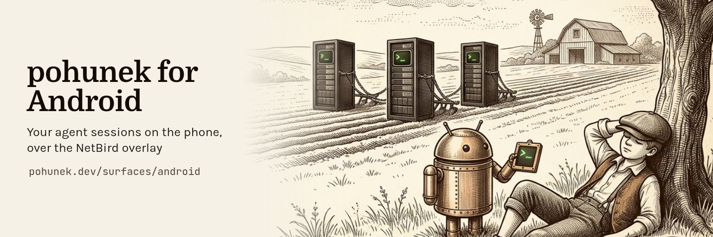

  <a href="https://pohunek.dev/surfaces/android/">pohunek.dev/surfaces/android</a>
  ·
  <a href="https://pohunek.dev/docs/">Pohunek docs</a>

# pohunek-companion-android

Native Android companion for [Pohunek](https://github.com/zajca/pohunek):
remote session list with live state and an embedded terminal over the NetBird
overlay (Kotlin, Jetpack Compose).

Installing a release APK and publishing one: [docs/release.md](docs/release.md).

Status: pre-release. The latest build is on the
[releases page](https://github.com/pohunekd/pohunek-companion-android/releases/latest);
installing it is described in [docs/release.md](docs/release.md). The
[Android page on pohunek.dev](https://pohunek.dev/surfaces/android/) describes
the app and [docs/architecture.md](docs/architecture.md) how it works.

## Screenshots

<table>
  <tr>
    <td align="center" valign="top">
      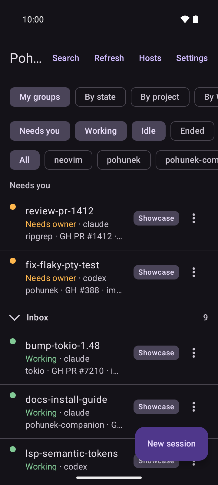 
      Every session on every host, with the ones that need you at the top.
    </td>
    <td align="center" valign="top">
      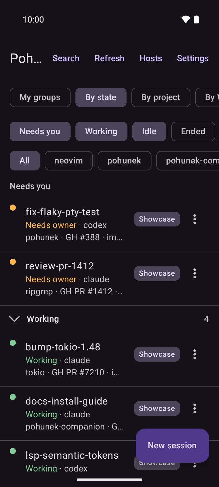 
      The same sessions grouped by what they are doing, so the ones waiting for you come first.
    </td>
    <td align="center" valign="top">
      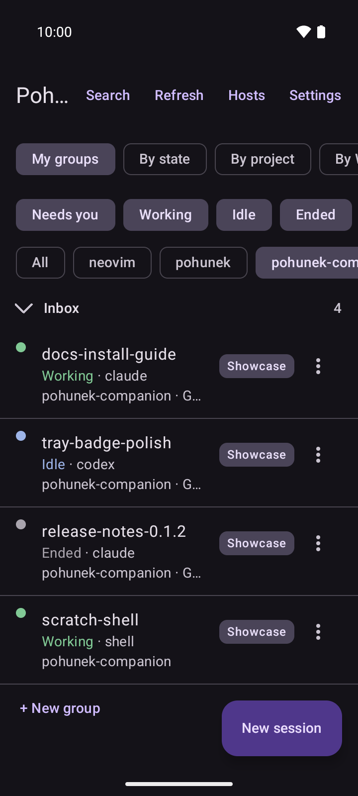 
      Narrow the list by state, project or host; here one project is shown with its ended sessions.
    </td>
  </tr>
  <tr>
    <td align="center" valign="top">
      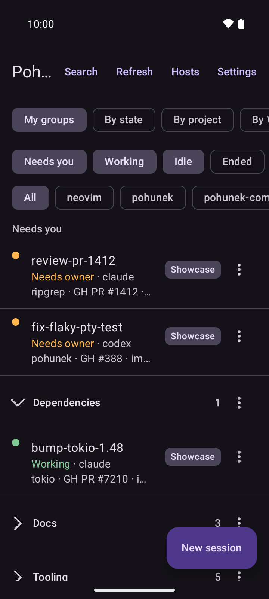 
      Your own groups, shared with the desktop app, hold the sessions you sort into them.
    </td>
    <td align="center" valign="top">
      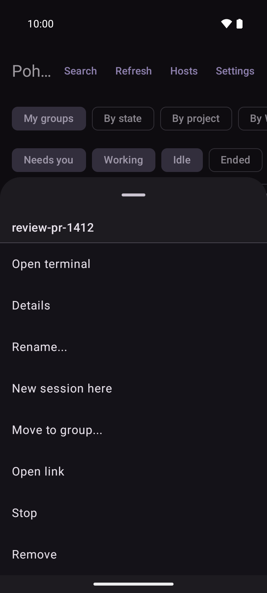 
      Every session row has an action sheet to open, rename, move, stop or remove it.
    </td>
    <td align="center" valign="top">
      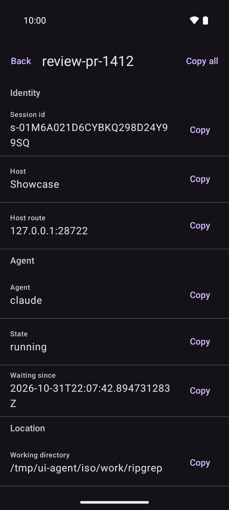 
      The identity, agent and location of one session, each field with a Copy button.
    </td>
  </tr>
  <tr>
    <td align="center" valign="top">
      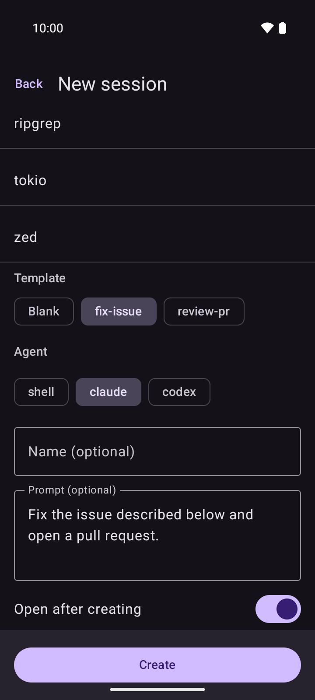 
      Start a session on a host from a project template, with its agent and prompt filled in.
    </td>
    <td align="center" valign="top">
      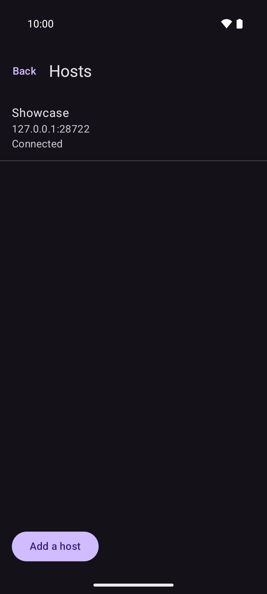 
      The hosts the app follows, each with its connection state.
    </td>
    <td align="center" valign="top">
      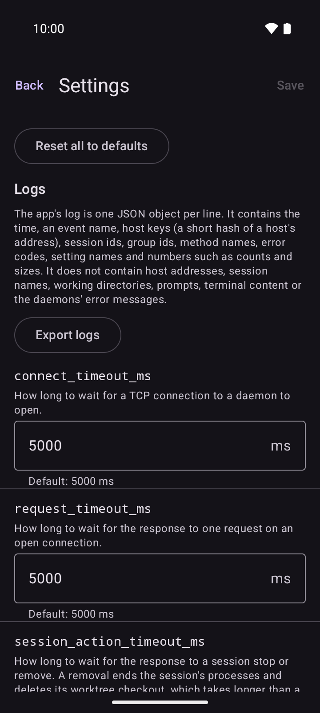 
      Every tunable of the app in one list, with its default and a reset.
    </td>
  </tr>
  <tr>
    <td align="center" valign="top">
      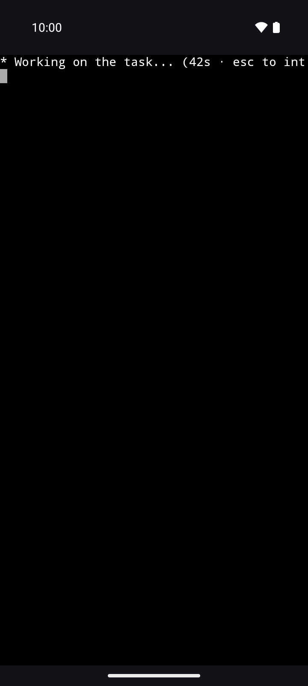 
      A full-screen terminal attached to a running session.
    </td>
  </tr>
</table>

The Android robot is reproduced or modified from work created and shared by
Google and used according to terms described in the Creative Commons 3.0
Attribution License.
